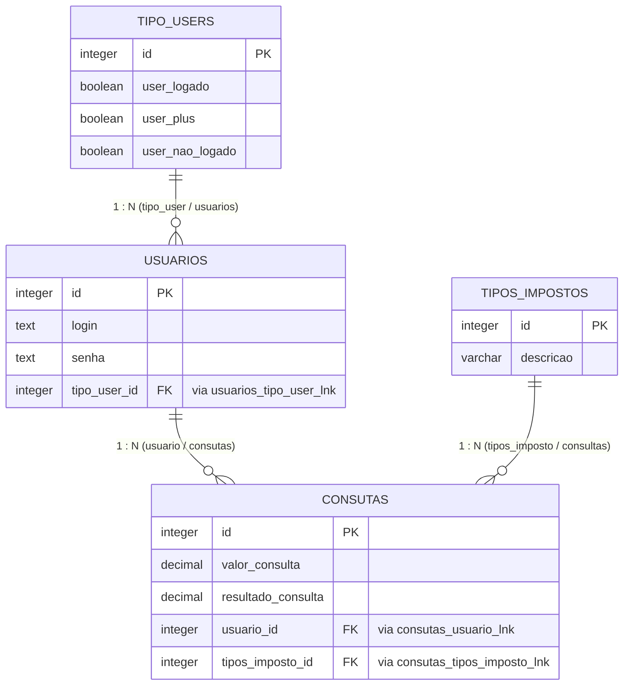

# Modelo Entidade-Relacionamento (MER) — Banco de Dados Tributo Fácil

Documentação do modelo entidade-relacionamento do banco de dados real da aplicação (**Strapi v5 + SQLite** em `backend/.tmp/data.db`), estruturada em formato de tabelas no estilo de [`modeloBD.png`](./modeloBD.png) e atualizada conforme os *content-types* definidos em `backend/src/api/`.

---

## 1. Diagrama Entidade-Relacionamento (Visão Geral)

---

## 2. Entidades em Formato de Tabela (Estilo `modeloBD.png`)

### `consutas` *(DisplayName no Strapi: `Consulta`)*

| Chave | Atributo (Strapi) | Coluna (SQLite) | Tipo (Strapi / SQLite) | Descrição |
| :---: | :--- | :--- | :--- | :--- |
| **PK** | **<u>id</u>** | **<u>id</u>** | `integer` (AUTOINCREMENT, NOT NULL) | Identificador único da consulta |
| — | `valor_consulta` | `valor_consulta` | `decimal` / `float` | Valor base informado para o cálculo/consulta |
| — | `resultado_consulta` | `resultado_consulta` | `decimal` / `float` | Resultado calculado da consulta |
| **FK** | `usuario` *(N:1)* | `usuario_id` *(via `consutas_usuario_lnk`)* | `relation` (`manyToOne`) / `integer` | Referência ao usuário dono da consulta (`usuarios.id`) |
| **FK** | `tipos_imposto` *(N:1)* | `tipos_imposto_id` *(via `consutas_tipos_imposto_lnk`)* | `relation` (`manyToOne`) / `integer` | Referência ao tipo de imposto aplicado (`tipos_impostos.id`) |

---

### `usuarios` *(DisplayName no Strapi: `Usuario`)*

| Chave | Atributo (Strapi) | Coluna (SQLite) | Tipo (Strapi / SQLite) | Descrição |
| :---: | :--- | :--- | :--- | :--- |
| **PK** | **<u>id</u>** | **<u>id</u>** | `integer` (AUTOINCREMENT, NOT NULL) | Identificador único do usuário |
| — | `login` | `login` | `text` / `text` | Login de acesso do usuário |
| — | `senha` | `senha` | `text` / `text` | Senha de acesso do usuário |
| **FK** | `tipo_user` *(N:1)* | `tipo_user_id` *(via `usuarios_tipo_user_lnk`)* | `relation` (`manyToOne`) / `integer` | Referência ao tipo/perfil do usuário (`tipo_users.id`) |

---

### `tipo_users` *(DisplayName no Strapi: `tipoUser`)*

| Chave | Atributo (Strapi) | Coluna (SQLite) | Tipo (Strapi / SQLite) | Descrição |
| :---: | :--- | :--- | :--- | :--- |
| **PK** | **<u>id</u>** | **<u>id</u>** | `integer` (AUTOINCREMENT, NOT NULL) | Identificador único do tipo de usuário |
| — | `userLogado` | `user_logado` | `boolean` / `boolean` | Indica se corresponde ao perfil de usuário logado |
| — | `userPlus` | `user_plus` | `boolean` / `boolean` | Indica se corresponde ao perfil de usuário plus |
| — | `userNaoLogado` | `user_nao_logado` | `boolean` / `boolean` | Indica se corresponde ao perfil de usuário não logado |

---

### `tipos_impostos` *(DisplayName no Strapi: `TiposImposto`)*

| Chave | Atributo (Strapi) | Coluna (SQLite) | Tipo (Strapi / SQLite) | Descrição |
| :---: | :--- | :--- | :--- | :--- |
| **PK** | **<u>id</u>** | **<u>id</u>** | `integer` (AUTOINCREMENT, NOT NULL) | Identificador único do tipo de imposto |
| — | `descricao` | `descricao` | `string` / `varchar(255)` | Descrição/nome do tipo de imposto |

---

## 3. Relacionamentos e Cardinalidades

| Entidade Origem (Lado `1`) | Cardinalidade | Entidade Destino (Lado `N`) | Atributos no Strapi | Tabela de Ligação Física (SQLite) | Regra de Integridade |
| :--- | :---: | :--- | :--- | :--- | :--- |
| `usuarios` (`Usuario`) | **1 : N** | `consutas` (`Consulta`) | `usuarios.consutas` (`oneToMany`, `mappedBy: "usuario"`) ↔ `consutas.usuario` (`manyToOne`, `inversedBy: "consutas"`) | `consutas_usuario_lnk` | `ON DELETE CASCADE` |
| `tipos_impostos` (`TiposImposto`) | **1 : N** | `consutas` (`Consulta`) | `tipos_impostos.consultas` (`oneToMany`, `mappedBy: "tipos_imposto"`) ↔ `consutas.tipos_imposto` (`manyToOne`, `inversedBy: "consultas"`) | `consutas_tipos_imposto_lnk` | `ON DELETE CASCADE` |
| `tipo_users` (`tipoUser`) | **1 : N** | `usuarios` (`Usuario`) | `tipo_users.usuarios` (`oneToMany`, `mappedBy: "tipo_user"`) ↔ `usuarios.tipo_user` (`manyToOne`, `inversedBy: "usuarios"`) | `usuarios_tipo_user_lnk` | `ON DELETE CASCADE` |

**Leitura dos relacionamentos:**
- Um **`Usuario`** pode realizar **N** **`Consulta`s**, e cada **`Consulta`** pertence a **1** **`Usuario`**.
- Um **`TiposImposto`** pode estar associado a **N** **`Consulta`s**, e cada **`Consulta`** refere-se a **1** **`TiposImposto`**.
- Um **`tipoUser`** pode classificar **N** **`Usuario`s**, e cada **`Usuario`** possui **1** **`tipoUser`**.

---

## 4. Tabelas Físicas de Ligação (`*_lnk`) no SQLite (Strapi v5)

No Strapi v5, mesmo relacionamentos `1 : N` (`manyToOne` / `oneToMany`) são persistidos fisicamente em tabelas auxiliares de ligação (`*_lnk`) com índice único no par de chaves e coluna de ordenação:

### `consutas_usuario_lnk`

| Chave | Coluna | Tipo | Referência |
| :---: | :--- | :--- | :--- |
| **PK** | **<u>id</u>** | `integer` | Chave primária da ligação |
| **FK** | `consuta_id` | `integer` | `consutas(id)` (`ON DELETE CASCADE`) |
| **FK** | `usuario_id` | `integer` | `usuarios(id)` (`ON DELETE CASCADE`) |
| — | `consuta_ord` | `float` | Ordem de relacionamento gerenciada pelo Strapi |

### `consutas_tipos_imposto_lnk`

| Chave | Coluna | Tipo | Referência |
| :---: | :--- | :--- | :--- |
| **PK** | **<u>id</u>** | `integer` | Chave primária da ligação |
| **FK** | `consuta_id` | `integer` | `consutas(id)` (`ON DELETE CASCADE`) |
| **FK** | `tipos_imposto_id` | `integer` | `tipos_impostos(id)` (`ON DELETE CASCADE`) |
| — | `consuta_ord` | `float` | Ordem de relacionamento gerenciada pelo Strapi |

### `usuarios_tipo_user_lnk`

| Chave | Coluna | Tipo | Referência |
| :---: | :--- | :--- | :--- |
| **PK** | **<u>id</u>** | `integer` | Chave primária da ligação |
| **FK** | `usuario_id` | `integer` | `usuarios(id)` (`ON DELETE CASCADE`) |
| **FK** | `tipo_user_id` | `integer` | `tipo_users(id)` (`ON DELETE CASCADE`) |
| — | `usuario_ord` | `float` | Ordem de relacionamento gerenciada pelo Strapi |

---

## 5. Observações Técnicas e Diferenças em Relação a `modeloBD.png`

1. **Nova entidade adicionada (`tipo_users`):** além das três entidades originais de `modeloBD.png` (`consulta`, `User` e `TiposImposto`), o banco implementado inclui a tabela `tipo_users` (`tipoUser`) ligada a `usuarios` em cardinalidade `1 : N`.
2. **Nomenclatura exata no banco/Strapi:**
   - A coleção de consultas foi criada no Strapi com o identificador `consuta` / tabela `consutas` (DisplayName: `Consulta`).
   - A entidade `User` do diagrama inicial foi implementada como `usuarios` (DisplayName: `Usuario`).
   - O campo `descricaco` de `modeloBD.png` foi corrigido no banco para `descricao` em `tipos_impostos`.
   - As chaves primárias no Strapi são padronizadas como `id` (em vez de `id_consulta`, `id_user`, `id_tiposImposto`).
3. **Colunas automáticas do Strapi v5:** todas as 4 tabelas de domínio (`consutas`, `usuarios`, `tipo_users`, `tipos_impostos`) possuem automaticamente os campos de metadados e `draftAndPublish`: `document_id` (`varchar(255)`), `created_at` (`datetime`), `updated_at` (`datetime`), `published_at` (`datetime`), `created_by_id` (`integer`, FK → `admin_users.id`), `updated_by_id` (`integer`, FK → `admin_users.id`) e `locale` (`varchar(255)`).
